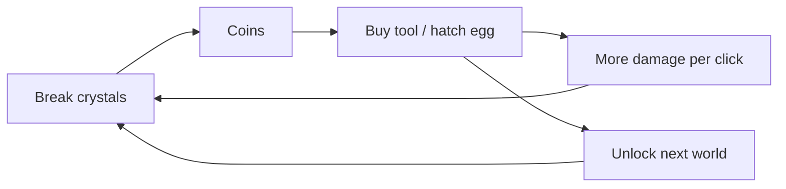

# Loops, progression and economy

## Contents
1. The loop stack
2. Designing the core loop
3. Meta loops and progression curves
4. Economy: sources, sinks, tuning
5. Rebirth / prestige
6. Session and daily loops
7. Social loops
8. Live ops loop
9. Ethical monetization
10. Tuning table template

---

## 1. The loop stack

| Loop | Length | Question it answers | Example (pet simulator) |
|---|---|---|---|
| Moment | 1–5 s | Does the verb feel good? | click/break a crystal, coins burst out |
| Core | 30 s–3 min | What am I doing right now? | break crystals → coins → buy bigger tool → break faster |
| Meta | 10 min–hours | What am I working toward? | hatch eggs → better pets → unlock next world |
| Session | one visit | Why stop here, why come back? | finish a quest, claim timed chest, see tomorrow's reward |
| Social | ongoing | Who am I playing with/against? | trade pets, show off rare pets, leaderboard |
| Live ops | weeks | What's new? | weekly update, limited event pet, new world |

Diagram each loop as `action → result → reward → investment → (better) action`. If any arrow is missing, the loop is broken: a reward that can't be invested in anything is a dead end; an action with no reward is a chore.



## 2. Designing the core loop

- **One verb, many contexts.** Depth comes from new places and modifiers for the same verb, not from new verbs every five minutes.
- **The loop must close within 2 minutes** for a new player, and each lap should be visibly better than the last (bigger numbers, faster, new effect).
- **Feedback on every step**: action (sound + particles), result (number pop), reward (counter animates, fly-to-UI), investment (celebration, new look), better action (bigger effect makes the improvement obvious).
- **Player choice** appears in the investment step: which upgrade, which pet, which path. Even small choices increase ownership.
- **Skill vs. time**: decide how much progress comes from skill (obbies, fighting) vs. time invested (simulators, tycoons). Both work; mixing them confusingly (pay to skip a skill gate) does not.

## 3. Meta loops and progression curves

Progression = how much effort each next step takes vs. how much it gives.

Common cost curves for step `n` (start cost `c0`):

| Curve | Formula | Feel | Use for |
|---|---|---|---|
| Linear | `c0 + k·n` | steady, quickly trivial | early tutorial steps |
| Polynomial | `c0 · n^p` (p ≈ 1.5–2.5) | gentle growth | levels/XP |
| Exponential | `c0 · r^n` (r ≈ 1.07–1.25) | grindy fast; needs exponential income | upgrades in idle/simulator games |

Rule: **income should grow with the same shape as costs**, so time-per-step stays in a designed band. Tune by *time*, not by raw numbers:

```
time to next step ≈ cost(n) / income_per_minute(n)
```

Design the target time per step first (e.g. first 5 upgrades: 20–60 s each; upgrades 6–20: 2–5 min; zone unlocks: 15–30 min of play), then derive costs from expected income. Put the numbers in a table (section 10) and check the first hour step by step.

Tips:
- **Front-load rewards**: very fast early steps, then gradually slower. The first hour must feel generous.
- **Staircase, not ramp**: alternate a hard step with a couple of easy ones; place big rewards just after difficulty spikes.
- **Visible next goal**: always show the cost of the next thing and a progress bar to it.
- **Big numbers need formatting** (1.2K, 3.4M, 5.6B) and a plan for overflow (Luau numbers are doubles: exact integers only up to 2^53; use mantissa/exponent for idle-game scales).

## 4. Economy: sources, sinks, tuning

- List every **source** (where currency enters: drops, quests, daily rewards, purchases) and every **sink** (where it leaves: upgrades, eggs, cosmetics, fees, rebirth). Each source should have a sink that stays attractive at every stage of the game.
- **Inflation** happens when late-game income dwarfs anything worth buying. Fixes: scaling sinks (cost grows with level), consumables, rebirth resets, cosmetic sinks, new-world currencies.
- **Separate currencies by purpose**: a soft currency (earned freely, spent on progression), optionally a premium currency (bought with Robux, spent on convenience/cosmetics), and event currencies (time-limited). More than three active currencies confuses players.
- **Trading economies** need: server-authoritative trades with both-sides confirmation, session-locked data (ProfileStore), anti-dupe audits, trade cooldowns for new accounts, value rarity carefully (once an item is in circulation, increasing its supply crashes its value and angers players).
- Log every source and sink with `AnalyticsService:LogEconomyEvent` and read the Economy dashboard: if one sink takes 90% of spending, the others are dead content.

## 5. Rebirth / prestige

Reset most progress in exchange for a permanent multiplier or new content.

- Offer the first rebirth when progress has clearly slowed (time per step > 2–3× the early game), typically 30–90 minutes into play.
- The multiplier must make the second run visibly faster (×1.5–×2 for the first rebirth) so the reset feels like a reward, not a loss.
- Show exactly what's kept and what's reset before confirming.
- Each rebirth tier can unlock something (a new world, pet slot, cosmetic) to add goals beyond the multiplier.

## 6. Session and daily loops

- **Session goals**: quests or objectives sized to 10–20 minutes, with the next one visible when one completes.
- **End-of-session hooks**: timed rewards ("Free chest in 4h"), plants that grow, offline earnings (capped), a daily quest set, a streak.
- **Daily login rewards**: escalating over 7 days, claimable in-game with a clear button. Don't make missing a day catastrophic (forgiving streaks retain better than harsh resets; consider a "streak freeze").
- **Playtime rewards**: small gifts at 5, 10, 20, 30 minutes of the session encourage longer sessions early on; show the next one counting down.
- **Cooldowns of ~20 h instead of 24 h** for daily claims, so a player on a daily routine never misses by minutes.

## 7. Social loops

- **Co-op**: shared objectives where more players = faster/better (team bosses, group obbies, shared tycoon plots). Shared rewards so helping is never a loss.
- **Competition**: leaderboards (global, server, friends), rounds with fair matchmaking, ranked tiers. Server leaderboards give everyone a chance; global leaderboards inspire the top 1%.
- **Expression and status**: cosmetics, titles, rare pets, visible ranks, house/plot decoration. Status needs an audience: make it visible to other players in the world, not only in a menu.
- **Trading and gifting**: powerful retention, also the biggest exploit surface (see economy).
- **Group rewards**: a small perk for joining the Roblox community group or liking/favoriting the game is common; keep it small and optional.

## 8. Live ops loop

- **Update cadence** matters more than update size: a predictable weekly or bi-weekly update with something new (an event, a world, a pet set, a balance pass) gives returning players a reason to check in. Announce update times in-game and in the community.
- **Events**: limited-time currency, items or areas; 1–3 weeks long; rewards obtainable by free players with reasonable play.
- Keep a backlog of content that can be released without code changes (Config-driven items, worlds built from existing components).
- Watch the metrics after each update (see playtesting-and-metrics.md) and keep what moved retention.

## 9. Ethical monetization

Roblox ways to earn: game passes (one-time permanent perks), developer products (repeatable purchases), experience subscriptions (recurring perks), private servers, avatar items, and Premium Payouts (engagement-based earnings from Premium subscribers' playtime, which reward fun alone). Check Roblox's current monetization and advertising policies before designing a shop; they change, and paid random items must disclose odds.

Sell:
- **Speed**: 2× coins, auto-collect, faster hatching (multipliers stack in players' heads; show the total).
- **Convenience**: extra inventory/pet slots, teleports, auto-rebirth, skip a cosmetic cooldown.
- **Expression**: skins, trails, emotes, titles, house items.
- **Access**: VIP area (with fun, not power), private servers, early access to a new world for a short window.
- **Support the dev**: a starter pack with clear good value after the first loop closes.

Avoid:
- Power that free players can't reach at all in competitive modes (pay-to-win drives away the free majority who make servers feel alive).
- Designing frustration (huge walls, punitive deaths) to sell the fix.
- Fake scarcity and fake countdowns, pressure popups, interrupting play with offers.
- Confusing currency conversions that hide the real Robux price.
- Loot boxes without disclosed odds (also against policy), or pity systems that are hidden.

Good placement: offers appear where the need is felt (the inventory full message has a "+slots" button), after a success, and in a shop the player opens themselves.

## 10. Tuning table template

| Step | Unlock | Cost | Income/min at this point | Time to afford | Target time | Reward feels like |
|---|---|---|---|---|---|---|
| 1 | Tool 2 | 25 | 60 | 25 s | 20–40 s | ×2 damage, new swing effect |
| 2 | Tool 3 | 120 | 150 | 48 s | 40–60 s | ×2 damage |
| 3 | Zone 2 | 1,000 | 300 | 3.3 min | 3–5 min | new biome, 3× drops |
| ... | | | | | | |

Fill it for the first hour of play at least; check every row against its target time and adjust costs (not targets). Then playtest, because real players earn slower than spreadsheets.
